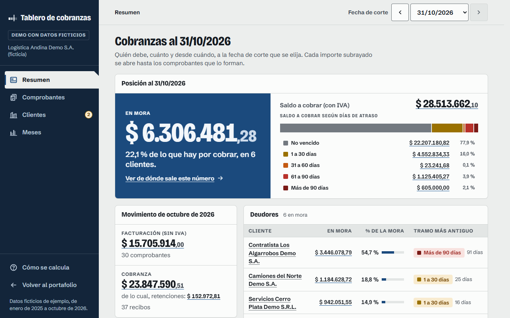
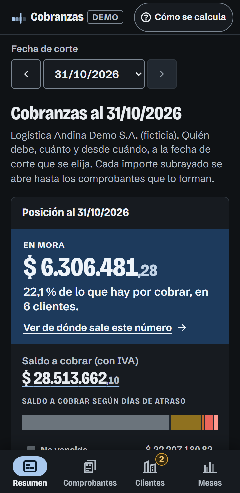
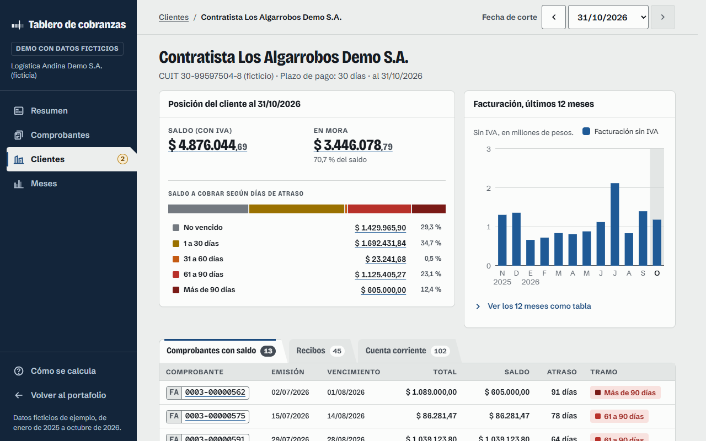
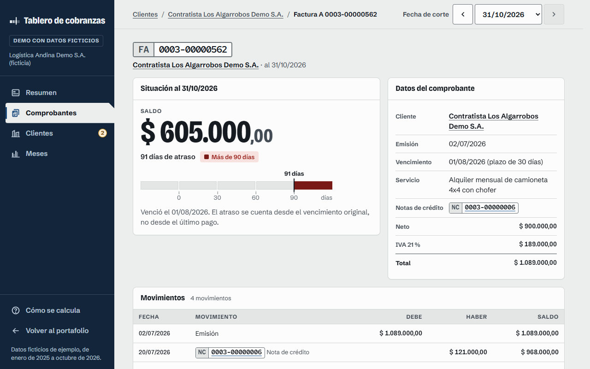
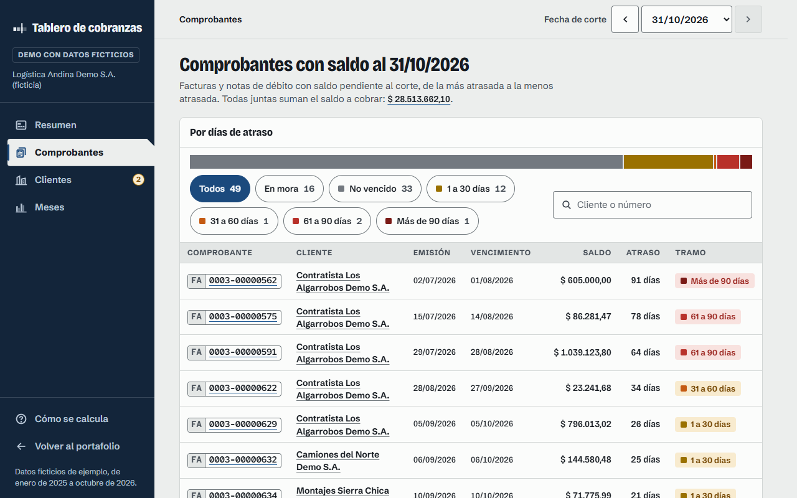
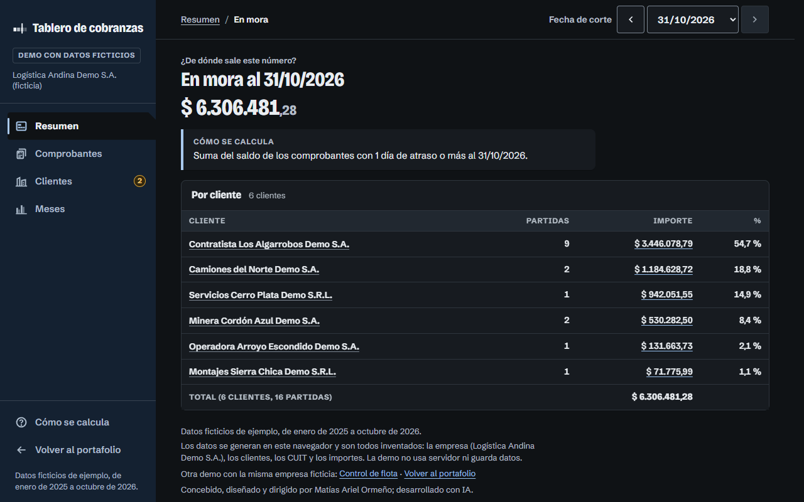

# Tablero de cobranzas (demo)

## In English

A receivables dashboard for a fictional fleet-services company: who owes, how much and since when, as of a cut-off date you can change. Every underlined amount drills down to the invoices behind it. All data is fictional and generated from a fixed seed; it runs entirely in the browser (no server, no login, no file uploads).

Stack: Svelte 5, Vite and TypeScript, with a single direct production dependency (`svelte`). To run it: `npm install`, then `npm run dev` (development server) and `npm test` (2,262 tests in 59 files).

Live demo: <https://tablero.matiasormeno.com.ar>

Conceived, designed and directed by Matías Ariel Ormeño; built with AI. The rest of this README, the interface and the identifiers in the code are in Spanish.

**Demo en vivo:** <https://tablero.matiasormeno.com.ar>

Tablero de **facturación, cobranza y mora** de una empresa ficticia de servicios de flota, con una fecha de corte que se puede cambiar. Responde "¿cuánto facturamos, cuánto cobramos y quién nos debe, desde cuándo?", y **cada importe subrayado se abre hasta el comprobante** que lo compone. Corre entero en el navegador: no hay servidor, ni login, ni carga de archivos.

| | |
| --- | --- |
|  |  |
|  |  |
|  |  |

*Capturas del build servido con la política de seguridad real, con el corte por defecto (31/10/2026).*

## Qué se puede hacer

Ocho pantallas, con la fecha de corte en la dirección (cada vista tiene un enlace permanente):

- **Resumen:** la mora, el saldo a cobrar repartido según días de atraso, el movimiento del mes (facturación y cobranza con sus retenciones), los deudores y lo que hay que revisar.
- **Comprobantes**, **Clientes** y **Meses:** las listas con saldo, la cartera por cliente y los doce meses facturados y cobrados, con filtros y búsqueda. En el celular, las tablas pasan a tarjetas.
- **Cliente** y **Comprobante:** la ficha con su posición, y el comprobante con su atraso, su lugar en la regla de tramos y sus movimientos (el saldo corre línea por línea; lo posterior al corte se ve aparte).
- **Desglose:** de dónde sale cada cifra, con las partidas que la suman.
- **Cómo se calcula:** las reglas en palabras, con ejemplos tomados de los datos de ejemplo de la demo.

La fecha de corte se elige entre los 22 cierres de mes (enero de 2025 a octubre de 2026): al cambiarla, todo se recalcula en el navegador y la pantalla se queda donde estaba.

**Movimiento.** Al cambiar de pantalla hay una transición corta (la pantalla sale en 110 ms y entra en 230 ms), y el número de un comprobante o el nombre de un cliente viaja de la tabla al título. **Al cambiar el corte no se anima nada** y ninguna cifra "cuenta": un importe que cuenta muestra importes falsos mientras cuenta. Con "reducir movimiento" activado en el sistema no hay ninguna transición.

## Arquitectura

Una sola dependencia directa de producción (`svelte`): el enrutador por *hash*, el estado y el gráfico (SVG) son propios. Orden de lectura sugerido, de lo que decide a lo que dibuja:

1. [`src/lib/dominio`](src/lib/dominio): las reglas de negocio, puras y sin importar nada de las otras capas. El dinero va en centavos (`dinero.ts`, tipo con marca `Centavos`). `medidas.ts` arma cada cifra por dos caminos (el valor por agregación y la lista de partidas) y `controlar` los compara: si difieren, lanza `ErrorDeCierre` y la pantalla no muestra el número.
2. [`src/lib/vistas`](src/lib/vistas): un modelo de vista por pantalla, como función pura de los datos y de la fecha de corte (por ejemplo, `vistaResumen(datos, corte)`). Toma las cifras del dominio (las medidas pasan por `medidaControlada`) y las deja listas para dibujar.
3. [`src/rutas`](src/rutas) y [`src/componentes`](src/componentes): Svelte. Solo dibujan lo que entregan las vistas; no suman ni controlan nada. La dirección y la memoria de cada vista viven en `src/lib/estado`.
4. [`scripts/oraculo.mjs`](scripts/oraculo.mjs): recalcula las 15 medidas con otra forma de contar y sin importar nada de `src/lib`.
5. [`tests/`](tests): el oráculo se prueba contra casos escritos a mano y verifica al dominio sobre los datos del generador; además, pruebas de propiedad sobre los 22 cierres y la prueba de mutaciones (`npm run mutaciones`).

## Cómo se garantiza que las cifras cierran

Cada cifra se calcula por **dos caminos independientes** (uno suma los datos crudos y otro lista comprobante por comprobante) y los resultados tienen que coincidir; además se cruzan entre sí (los tramos contra el saldo, los clientes contra el total, la cuenta corriente contra el saldo neto). Si un control falla, la pantalla no muestra la cifra: muestra el error.

- Un test de propiedad (50 semillas, los 22 cierres de mes, todas las medidas, la empresa y cada cliente) con tres mutaciones plantadas falla si alguna suma se rompe.
- Un oráculo independiente (`scripts/oraculo.mjs`, que no importa nada del dominio) recalcula los resultados de referencia.
- Una prueba de mutaciones (`npm run mutaciones`): 60 cambios plantados en el código; cada uno tiene que hacer fallar algún test.
- El dinero va en **centavos enteros**, con un tipo con marca que el compilador hace cumplir (un `number` suelto no compila donde se pide dinero), y una búsqueda de respaldo (`npm run buscar`) prohíbe `toFixed`, `Math.round` y similares en el dominio.

## Datos ficticios

La empresa ("Logística Andina Demo S.A."), los clientes, los CUIT, las personas y los montos son inventados y se generan con una semilla fija en el navegador. Los importes son de ficción y las retenciones no son alícuotas vigentes de ninguna jurisdicción. Todos los CUIT llevan la palabra "ficticio".

Los datos salen de la **semilla `20261122`, huella `e9274f2c`** (FNV-1a de 32 bits del JSON canónico de los datos; 690 comprobantes y 618 recibos entre el 01/01/2025 y el 31/10/2026). Si el generador cambia, un test falla hasta que se actualiza la huella a propósito. La semilla y la huella no se muestran en la aplicación.

Criterio de la semilla: se eligió para que la muestra tenga más de cinco deudores en mora (así existe «Otros») y deuda en los cinco tramos al corte por defecto. Es la primera que las cumple a partir de `20261118`. Elegir una entre varias es elegir el relato: el generador no fuerza ningún resultado y las cifras de referencia valen solo para esta semilla.

## Quién hizo qué

Concebido, diseñado y dirigido por **Matías Ariel Ormeño**; desarrollado con IA (modelos de Anthropic, en distintos roles: diseño de interfaz, redacción, programación, maquetación, revisión de código, pruebas destructivas y accesibilidad), bajo su dirección. Hoy diseña los sistemas y dirige su desarrollo con IA.

Dos decisiones de fondo son suyas y puede explicarlas:

- **Qué muestra el tablero y cómo se abre:** quién debe, cuánto y desde cuándo, a una fecha de corte elegible, con cada importe abierto hasta los comprobantes que lo forman.
- **Que cada cifra se controle:** los totales se verifican por dos caminos independientes y hay pruebas que lo demuestran.

También definió las reglas de negocio, la semilla de los datos, los textos de la interfaz y lo que queda afuera, aprobó el prototipo de la interfaz y revisó las pantallas y los importes. El registro de cada decisión, con quién la tomó, está en [`docs/registro.md`](docs/registro.md).

## Cómo correrla y verificarla

Node 24. `npm ci` y después:

| Comando | Qué hace |
| --- | --- |
| `npm run dev` | Servidor de desarrollo (puerto 5173). |
| `npm run build` y `npm run servir` | Compila y sirve `dist/` con la misma política de seguridad que se aplicará al publicar (`default-src 'none'`, todo en `'self'`, sin estilos ni scripts en línea). Abrir <http://127.0.0.1:4173/>. |
| `npm run check` | Tipos de TypeScript y de los componentes Svelte (0 errores). |
| `npm test` | Pruebas (Vitest). `npm run test:tz` las repite en tres zonas horarias. |
| `npm run buscar` | Búsqueda de código prohibido: `{@html}`, `innerHTML`, `Math.random`, `new Date(` en el dominio, dinero sin el tipo con marca, nombres de terceros. La regla de nombres usa `scripts/prohibidos.local.json`, un archivo local que no se versiona: sin él se omite con un aviso. |
| `npm run contraste` | Mide el contraste de cada par de colores de la paleta, en claro y oscuro. |
| `npm run peso` | Mide el JavaScript con gzip contra el tope de 100 kB. |
| `npm run mutaciones` | Las 60 mutaciones plantadas (unos 7 minutos; edita `src/lib` mientras corre). |

**Integración continua:** el archivo `.github/workflows/ci.yml` define el flujo que se ejecuta en cada `push` y en cada `pull request`: instala desde el archivo de bloqueo (`npm ci --ignore-scripts`) y corre `npm run check`, `npm test`, `npm run test:tz`, `npm run build`, `npm run peso`, `npm run buscar` y `npm audit --audit-level=high`.

### Cifras de esta versión

| Qué | Resultado |
| --- | --- |
| Pruebas | 2.273 en 59 archivos, en verde también en UTC, Asia/Tokyo y America/Los_Angeles |
| Mutaciones plantadas | 60 de 60 detectadas (corrida del 26/11/2026: 6 min 49 s; ver `docs/registro.md`) |
| JavaScript | 82,1 kB con gzip (tope: 100 kB), con una sola dependencia directa de producción (`svelte`) |
| CSS | 13,6 kB con gzip |
| Tipografías | 201 kB (`woff2`, alojadas en el propio sitio; licencias OFL junto a los archivos) |
| Contraste | 206 mediciones, 0 fallan, 6 justas |
| Consola y política de seguridad | Sin errores ni violaciones en las ocho pantallas, a 360 y 1440 px, en claro y oscuro (Chromium), y en Firefox a 360 y 1440 px, en claro; revisado el 26/11/2026 con la política ya acotada a lo que la demo usa (sin `blob:`, workers ni manifiesto) |

## Límites

- **Todo es de ejemplo.** No carga datos del usuario (ni CSV ni Excel), no guarda nada y no tiene servidor, login ni base de datos. El calendario es fijo: si se mira después de octubre de 2026, los datos "se ven viejos".
- **La fecha de corte es un cierre de mes** (22 opciones), no cualquier día.
- **Fuera de alcance:** intereses por mora, varias monedas, facturas B, C y E, feriados, contabilidad, conciliación bancaria, cheques diferidos, proyecciones y edición de datos. No aplica reglas fiscales: las retenciones son un dato más del recibo.
- **Probado en Chromium** (con Playwright, contra el build servido con la política de seguridad real), en el **Firefox de Playwright** (se recorrió con las mismas pruebas que Chromium) y de forma parcial en el WebKit de Playwright. **No se probó en Safari real ni con un lector de pantalla real**, y los colores forzados del sistema solo están resueltos por CSS, sin mirarlos en uso.
- **Transición entre pantallas:** usa View Transitions solo en Chrome y Chromium, que es donde se probó; en cualquier otro navegador entra una animación de CSS equivalente, con el mismo resultado final.
- **Nombres y CUIT inventados:** no se verificó que no coincidan con los de empresas reales.

## Origen y licencia

Escrito desde cero, con datos ficticios; no usa código, datos ni documentos de terceros. Algunas piezas se copiaron de la Demo 2 (Control de flota, del mismo autor, licencia MIT) con su procedencia anotada en [`docs/procedencia.md`](docs/procedencia.md). Licencia MIT (archivo `LICENSE`).

## Documentos

Lo de `docs/` son **notas de trabajo** del proyecto (especificación, decisiones, registro): no hace falta leerlas para entender el código. Si se lee una, que sea [`docs/diseno.md`](docs/diseno.md): los identificadores que aparecen en los comentarios y en los tests (`D2`, `M4`, `A1`…) son reglas de ese documento.

| Documento | Contenido |
| --- | --- |
| [`docs/diseno.md`](docs/diseno.md) | Modelo de datos, generador, reglas de negocio con su identificador y un caso con números, y fixtures de prueba. |
| [`docs/diseno-ui.md`](docs/diseno-ui.md) | Especificación de pantallas y sistema visual (movimiento en 3.6). |
| [`docs/stack.md`](docs/stack.md) | Tecnología elegida (Vite, TypeScript y Svelte 5), dependencias, estructura y verificación. |
| [`docs/plan.md`](docs/plan.md) | Etapas E0 a E8, con criterio de terminado. |
| [`docs/procedencia.md`](docs/procedencia.md) | Qué se copió de la Demo 2, de dónde y con qué cambios. |
| [`docs/registro.md`](docs/registro.md) | Historia de decisiones y de cada etapa. |
